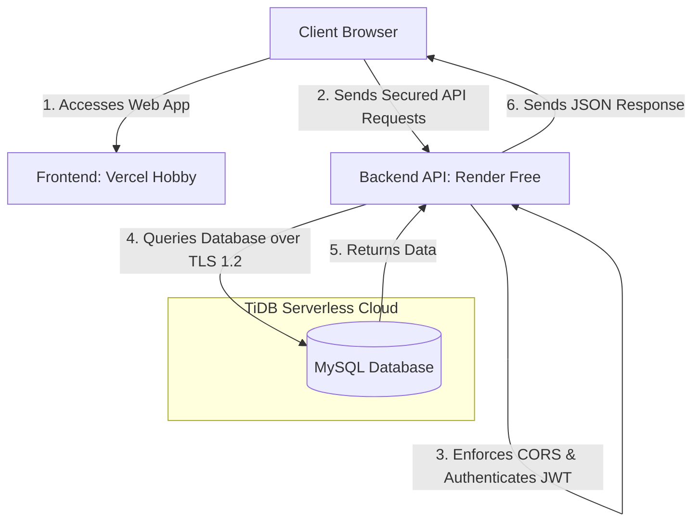

# 🚀 CodeNest Free Academy — Deployment & Hosting Documentation

This document provides a comprehensive blueprint of the production deployment of **CodeNest Free Academy**. It details the cloud infrastructure, hosting architecture, environment configuration, and a detailed step-by-step history of failures and resolutions encountered during the deployment process.

---

## 🏗️ 1. Production Architecture Overview

CodeNest Free Academy is deployed as a fully decoupled, secure, and production-ready full-stack application. It leverages a modern cloud stack:

*   **Frontend:** React 19 + Vite + TailwindCSS, hosted on **Vercel Hobby** as a static build.
*   **Backend:** Node.js + Express.js API server, hosted on **Render Free** as a web service.
*   **Database:** **TiDB Cloud (Serverless)**, providing a highly scalable, MySQL-compatible relational database with enforced SSL connections.

### Deployment Flowchart



---

## 🗄️ 2. Database Infrastructure (TiDB Cloud)

The local MySQL database was migrated to a secure, cloud-based **TiDB Serverless Cluster** on AWS (`ap-southeast-1` region) to ensure data persistence and reliable access for production.

### Database Environment
Production database credentials are stored only in hosting provider environment variables and local `.env` files that are ignored by Git.

Required backend variables:
```env
# Database Configuration (TiDB Cloud Serverless)
DB_HOST=<tidb-cluster-host>
DB_PORT=4000
DB_USER=<tidb-cluster-user>
DB_PASSWORD=<tidb-cluster-password>
DB_NAME=<tidb-database-name>
DB_SSL=true

# Security & Roles
JWT_SECRET=<strong-random-32char-secret>
OWNER_EMAIL=<configured-academy-owner-email>

# CORS & Domain Routing
FRONTEND_URL=<vercel-production-url>
CORS_ORIGIN=<vercel-production-url>

# Storage Configuration (Cloudflare R2)
STORAGE_PROVIDER=r2
R2_ACCOUNT_ID=<cloudflare-account-id>
R2_ACCESS_KEY_ID=<cloudflare-r2-access-key-id>
R2_SECRET_ACCESS_KEY=<cloudflare-r2-secret-access-key>
R2_BUCKET_NAME=codenest-attachments
MAX_NOTE_FILE_SIZE_MB=25
```

*   **SSL Requirement:** Enforced (TLS v1.2 minimum version)

---

## 🗄️ 3. Database Migration & Schema Deployment Guide

### Confirmed Migration Runner Behaviour
*   **Automated Script:** `node backend/scripts/migrate.js`
*   **Actual Execution Scope:** The automated migration runner reads and executes **only** two files:
    1. `backend/sql/schema.sql` (Creates core tables: `users`, `courses`, `modules`, `enrollments`, `progress`, `activity_logs`, and `notes`).
    2. `backend/sql/seed.sql` (Inserts initial seed data for 10 free courses and modules).
*   **Manual / Standalone Migration Files:**
    *   `backend/sql/add_notes_table.sql`: Dedicated standalone DDL for creating the `notes` table on older v1.0 databases where `notes` was not part of the initial `schema.sql`.
    *   `backend/sql/add_token_version.sql`: Adds the `token_version` column to the `users` table for session revocation. **This migration is NOT run by `migrate.js` and must be executed manually.**

### Verified Execution Sequence
For establishing or upgrading the database, execute scripts in the following order:
1. `backend/sql/schema.sql` (Idempotent: Uses `CREATE TABLE IF NOT EXISTS`).
2. `backend/sql/seed.sql` (Idempotent: Uses `INSERT INTO ... SELECT ... WHERE NOT EXISTS`).
3. `backend/sql/add_notes_table.sql` (Idempotent: Uses `CREATE TABLE IF NOT EXISTS`; skip if already present in `schema.sql`).
4. `backend/sql/add_token_version.sql` (**NON-IDEMPOTENT**: Read below).

### Critical DDL & Idempotency Warnings
*   **Non-Idempotent DDL (`add_token_version.sql`):** Running `ALTER TABLE users ADD COLUMN token_version ...` twice will throw MySQL Error 1060 (`Duplicate column name`). Operators **must** execute the preflight check before applying:
    ```sql
    SELECT COUNT(*) AS column_exists
    FROM INFORMATION_SCHEMA.COLUMNS
    WHERE TABLE_SCHEMA = DATABASE()
      AND TABLE_NAME = 'users'
      AND COLUMN_NAME = 'token_version';
    ```
    *If `column_exists = 1`, skip the statement.*
*   **No Automated Migration Tracking:** The codebase currently has no `schema_migrations` tracking table. Migration status must be tracked and documented manually by operators.
*   **Implicit Commits on DDL:** In MySQL and TiDB, DDL statements (`CREATE TABLE`, `ALTER TABLE`) trigger implicit transaction commits and **cannot be rolled back** using a standard SQL rollback. Always take a backup before running DDL migrations in production.

---

## 💾 4. Database Backup & Disaster Recovery Runbook

### Confirmed Repository Behaviour vs. Operator Verification
*   **Repository State:** The repository contains no scheduled backup scripts or backup automation tasks.
*   **External Cloud Provider:** TiDB Cloud Serverless provides cluster snapshot mechanisms, but operational parameters must be verified manually by operators.

### Operator Actions: Dashboard Verification *(Requires TiDB Cloud Access)*
Before promoting schema changes or declaring production readiness, operators must verify:
1.  **TiDB Cloud Console Navigation:** Sign in to PingCAP TiDB Cloud Console -> Clusters -> Select Cluster -> **Backup & Restore**.
2.  **Snapshot Schedule & Frequency:** Verify whether automated daily snapshots are active.
3.  **Retention Window:** Confirm how many days of snapshots are retained (e.g. 7 days vs. 30 days).
4.  **Restore Availability:** Verify whether snapshot restore creates a new cluster or allows in-place restore.
5.  **Cluster IAM Permissions:** Ensure only authorized operations personnel have restore and export permissions.

### On-Demand Logical Backup Procedure (Pre-Deployment)
Before applying migrations or structural changes, an operator should generate a point-in-time logical backup over a secure TLS 1.2 connection using standard utilities:
```bash
# Example on-demand logical backup via mysqldump (Requires operator credentials)
mysqldump -h <tidb-host> -P 4000 -u <tidb-user> -p \
  --ssl-mode=REQUIRED \
  --single-transaction \
  --databases <tidb-database-name> > codenest_backup_$(date +%Y%m%d_%H%M%S).sql
```
*   **Encryption & Security:** Never store backup SQL dumps in the project root, public directories, or version control. Backups must be encrypted at rest and stored in an access-controlled cold-storage destination.

### Post-Restore Validation Checklist
Following any database restore operation, operators must execute the following validation steps:
1.  **Connectivity & Health Probe:** Run `curl -i https://<render-backend-url>/api/health` to confirm HTTP 200 and `"database": "connected"`.
2.  **Row Count Sanity Check:** Verify table record counts against pre-incident benchmarks:
    ```sql
    SELECT 'users' AS tbl, COUNT(*) AS count FROM users
    UNION ALL SELECT 'courses', COUNT(*) FROM courses
    UNION ALL SELECT 'modules', COUNT(*) FROM modules
    UNION ALL SELECT 'enrollments', COUNT(*) FROM enrollments
    UNION ALL SELECT 'progress', COUNT(*) FROM progress
    UNION ALL SELECT 'notes', COUNT(*) FROM notes;
    ```
3.  **Foreign Key & Index Integrity:** Confirm that cascade relations and unique constraints function as expected.
4.  **Authentication Test:** Confirm that student login and Owner login function correctly.

### Recovery Objectives *(Decisions Pending Project Owner Confirmation)*
*   **Suggested RPO (Recovery Point Objective):** `< 24 hours` (Maximum acceptable data loss window). *Status: Pending Project Owner Sign-Off.*
*   **Suggested RTO (Recovery Time Objective):** `< 2 hours` (Target window to restore database and resume API services). *Status: Pending Project Owner Sign-Off.*

---

## 📦 5. Storage Operations Runbook (Cloudflare R2 & Local Fallback)

### Architecture Overview
CodeNest Free Academy features a dual-mode storage adapter ([`backend/config/storage.js`](file:///C:/CodeNest/backend/config/storage.js)):
*   **Production Storage (Cloudflare R2):** S3-compatible cloud object storage. Uploads are streamed in-memory via Multer (`multer.memoryStorage()`) and uploaded to Cloudflare R2 using `@aws-sdk/client-s3`.
*   **Development Fallback (Local Disk):** Files are written to `backend/uploads/notes/` via Multer disk storage and served through static route `/uploads`.

### Storage Operations & Lifecycle
1.  **File Upload:**
    *   Files are sanitized and given a unique timestamped key (`notes/<timestamp>_<random>_<basename>`).
    *   Uploaded with explicit `ContentType` and `ContentDisposition` containing URL-encoded filename.
2.  **File Download (Presigned URLs):**
    *   R2 attachments are accessed via short-lived pre-signed URLs generated with `@aws-sdk/s3-request-presigner` (default TTL: **300 seconds / 5 minutes**).
    *   Private object URLs prevent unauthorized direct access or URL scraping.
    *   Local files are served with strict path-traversal protection verifying the canonical path remains within `backend/uploads/notes/`.
3.  **File Deletion & Failure Handling:**
    *   Deleting a note triggers `storage.deleteAttachment(note.file_url)`.
    *   If R2 deletion fails, the controller aborts with HTTP 502 and retains the database record, preventing orphaned metadata.

### Operational Risks & Guardrails
*   **Render Ephemeral Disk Risk:** Render Web Service containers have ephemeral storage. Any file stored to local disk is permanently lost whenever the container restarts, sleeps due to inactivity, or redeploys.
    *   *Production Guardrail:* [`storage.js`](file:///C:/CodeNest/backend/config/storage.js) includes a fail-fast check: if `NODE_ENV=production` and `STORAGE_PROVIDER=r2` but credentials are missing, the server throws an error on startup rather than silently falling back to ephemeral local storage.
    *   *Operational Requirement:* Operators **must** explicitly configure `STORAGE_PROVIDER=r2` and the four `R2_*` environment variables in the Render dashboard.
*   **Provider Switching Incompatibility:**
    *   R2 object keys (`notes/...`) and local disk URLs (`/uploads/notes/...`) are distinct.
    *   Files uploaded to R2 are not mirrored locally; files uploaded locally are not mirrored to R2.
    *   Switching `STORAGE_PROVIDER` will render existing attachments stored on the other provider inaccessible.

### Operator Actions: Dashboard Verification *(Requires Cloudflare Dashboard Access)*
1.  **Bucket Existence:** Confirm that bucket `codenest-attachments` exists in Cloudflare R2.
2.  **Bucket Versioning:** Verify whether Object Versioning is enabled to protect against accidental file deletions.
3.  **CORS & Access Rules:** Ensure the bucket allows access from the backend's presigner.
4.  **API Token Permissions:** Confirm that the R2 API token has `Object Read & Write` permissions scoped to the specific bucket.

---

## 📝 6. Notes Management System Architecture

The **Notes Management System** enables Course Owners to create, manage, and attach downloadable study materials (PDFs, DOCX, PPTX, TXT, images) to courses and modules, and allows students to access published study materials.

### Notes Database Table (`notes`)
* `id` (INT, Primary Key, Auto Increment)
* `title` (VARCHAR 255, NOT NULL)
* `description` (TEXT)
* `content` (LONGTEXT — markdown/text lecture notes)
* `course_id` (INT, Foreign Key -> `courses.id` ON DELETE CASCADE)
* `module_id` (INT, NULLABLE, Foreign Key -> `modules.id` ON DELETE SET NULL)
* `file_url` (VARCHAR 1000 — relative/cloud URL to attachment)
* `file_name` (VARCHAR 255 — original uploaded filename)
* `file_type` (VARCHAR 50 — formatted extension e.g. PDF, DOCX, TXT)
* `file_size` (INT — file size in bytes)
* `status` (ENUM('draft', 'published'), default 'draft')
* `created_by` (INT, Foreign Key -> `users.id` ON DELETE CASCADE)
* `created_at` / `updated_at` (TIMESTAMP)

### API Endpoints
* **Student / Public**:
  * `GET /api/notes?course_id={id}&module_id={id}&search={query}` — Fetch published notes
  * `GET /api/notes/:id` — Fetch single note detail
  * `GET /api/notes/:id/download` — Download note attachment via signed URL redirect
* **Owner Management** (`authMiddleware` + `ownerMiddleware`):
  * `GET /api/owner/notes` — Fetch all notes (draft + published) with summary statistics
  * `POST /api/owner/notes` — Create note (supports `multipart/form-data` with `file`)
  * `PUT /api/owner/notes/:id` — Update note and/or replace attached file
  * `PATCH /api/owner/notes/:id/status` — Toggle/update publish status (`draft` / `published`)
  * `DELETE /api/owner/notes/:id` — Delete note and cleanup stored file

### Storage & Upload Limits
* **Cloud Storage (Production)**: Streamed in-memory to Cloudflare R2 bucket `codenest-attachments`.
* **Local Storage (Development)**: Stored in `backend/uploads/notes/` and served via static route `/uploads`.
* **Allowed Formats**: `.pdf`, `.doc`, `.docx`, `.ppt`, `.pptx`, `.txt`, `.png`, `.jpg`, `.jpeg`, `.webp`, `.gif`
* **Size Limit**: Default 25MB (configurable via `MAX_NOTE_FILE_SIZE_MB` env variable).

---

## 🚀 7. Application Hosting Details

The frontend and backend are deployed as separate services connected to the same GitHub repository.

### 🌐 Backend Web Service
*   **Provider:** Render Free Web Service
*   **Root Directory:** `backend`
*   **Build Command:** `npm install`
*   **Start Command:** `npm start`
*   **Runtime:** Node.js
*   **Port:** provided by `process.env.PORT`

### 💻 Frontend Static Service
*   **Provider:** Vercel Hobby
*   **Framework:** Vite
*   **Root Directory:** `frontend`
*   **Install Command:** `npm install --legacy-peer-deps`
*   **Build Command:** `npm run build`
*   **Output Directory:** `dist`
*   **Environment Variable:** `VITE_API_URL=<render-backend-url>`

---

## 🛠️ 8. Deployment Timeline & Failure Resolutions

During the migration from local development to production, several issues were encountered and successfully resolved:

### 🔴 Failure 1: LocalTunnel Instability & Disconnections
*   **Symptoms:** During initial testing, `localtunnel` was used to expose the backend server. The tunnel frequently reset, resulting in HTTP `504 Gateway Timeout` or connection refused errors.
*   **Resolution:** Decided to migrate to fully managed cloud hosting on Render rather than relying on development tunnels.

### 🔴 Failure 2: Empty/Corrupted React Files & Blank Page Crash
*   **Symptoms:** During editing, essential frontend files (`Login.jsx`, `Register.jsx`, `ProtectedRoute.jsx`, `AuthContext.jsx`) were corrupted and truncated to 0 bytes. This caused a complete React runtime compilation failure and a blank white screen.
*   **Resolution:** Identified the corrupted files, extracted the original clean page structures and AuthContext state logic from recovery logs, restored the file contents, and verified page mounting locally.

### 🔴 Failure 3: Monorepo Build and Lockfile Out-of-Sync Errors
*   **Symptoms:** Hosted builds can fail when the wrong root directory is selected or when a lockfile is out of sync with `package.json`.
*   **Resolution:** Configure provider root directories explicitly: `backend` for Render and `frontend` for Vercel.

---

## 📋 9. Operational Checklist & Runbooks

### 🛫 Pre-Deployment Checklist
Before triggering or approving a production build on Render or Vercel:
1.  **Code & Test Review:** Verify that all test suites pass cleanly (`node --test backend/tests/*.test.js`).
2.  **Pending Database Migrations:**
    *   Inspect `backend/sql/` for pending DDL/DML.
    *   If `add_token_version.sql` is pending, run the preflight check to confirm `token_version` does not already exist.
    *   Confirm that schema changes are non-breaking and compatible with live code.
3.  **Manual Database Backup Verification:** *(Requires TiDB Cloud Access)*
    *   Check TiDB Cloud console to verify an automated snapshot was successfully created within the last 24 hours.
    *   If performing major schema changes, generate an on-demand logical backup using `mysqldump` over TLS 1.2.
4.  **Hosting Environment Variables:** *(Requires Render / Vercel Dashboard Access)*
    *   Verify `STORAGE_PROVIDER=r2` is set in Render environment variables.
    *   Verify `R2_ACCOUNT_ID`, `R2_ACCESS_KEY_ID`, `R2_SECRET_ACCESS_KEY`, and `R2_BUCKET_NAME` are populated.
    *   Verify `FRONTEND_URL` and `CORS_ORIGIN` point to the active production Vercel domain.
    *   Verify `VITE_API_URL` on Vercel points to the active Render backend URL.
5.  **Rollback Plan Alignment:** Confirm the previous successful Git commit hash on the main branch for rapid revert.

---

### 🛬 Post-Deployment Checklist
Immediately following a production deployment:
1.  **System Health & Connectivity Probe:**
    *   Execute `curl -i https://<render-backend-url>/api/health`
    *   Verify HTTP status `200 OK`.
    *   Verify JSON body contains `"database": "connected"`, `"status": "CodeNest Backend is running ✅"`, and a valid `latency_ms` reading.
2.  **Public API Cache & Content Probe:**
    *   Execute `curl -i https://<render-backend-url>/api/courses`
    *   Verify HTTP status `200 OK`.
    *   Verify response headers include `X-Request-Id`, `Cache-Control: public, max-age=60...`, and `Vary: Authorization, Accept-Encoding`.
    *   Verify JSON contains published courses with valid module and enrollment counts.
3.  **Frontend Availability:**
    *   Visit the live frontend URL (`https://coding-academy-pro-free-course.vercel.app`).
    *   Verify homepage loads without white-screen or React console errors.
    *   Verify Course Card thumbnails render correctly with lazy loading.
4.  **Structured Log Inspection:** *(Requires Render Dashboard Access)*
    *   Inspect Render Web Service deployment logs.
    *   Confirm clean startup: `✅ Database Connected: [TiDB Cloud Cluster]/<db_name>` (no raw credentials exposed).
    *   Check HTTP request log stream for unexpected 5xx status codes or unhandled rejection warnings.
5.  **Safe Storage Verification Procedure:**
    *   Sign in with the configured Owner account.
    *   Create a test note draft with a small sample PDF attachment.
    *   Verify upload succeeds and `file_url` starts with `notes/` (confirming R2 persistence).
    *   Trigger download and verify the presigned URL redirect works.
    *   Delete the test note and verify the file is removed from R2 without leaving orphaned records.

---

### 🚨 Incident Recovery & Rollback Runbook

#### 1. Severity Assessment & Escalation
*   **Sev 1 (Outage / Data Issue):** Complete service unavailability, database connection failure, or corrupted data. Escalate immediately to Academy Owner / Operations Lead.
*   **Sev 2 (Degraded Performance / Broken Feature):** Specific API endpoints failing, attachment uploads/downloads failing, or elevated response latency.

#### 2. Backend Rollback Procedure (Render)
If the backend deployment causes an outage or breaking API regression:
1.  Open **Render Dashboard** -> Select the CodeNest Backend Web Service.
2.  Navigate to the **Deploys** tab.
3.  Locate the previous stable deployment (the last deployment known to be healthy).
4.  Click the options menu (`...`) next to the target deployment and select **Rollback to this deploy** (or trigger a manual deploy specifying the last stable Git SHA).
5.  Monitor build logs to confirm the rollback container boots and passes the `/api/health` probe.

#### 3. Frontend Rollback Procedure (Vercel)
If the frontend deployment causes white-screen crashes or client-side routing failures:
1.  Open **Vercel Dashboard** -> Select the `coding-academy-pro-free-course` project.
2.  Navigate to the **Deployments** tab.
3.  Locate the last successful deployment prior to the incident.
4.  Click the options menu (`...`) and select **Instant Rollback**.
5.  Vercel immediately shifts edge CDN routing to the previous build within seconds without rebuilding.
6.  Hard-refresh browser (`Ctrl+F5`) to confirm the restored UI.

#### 4. Database Disaster Recovery Decision
*   **Minor Schema Error:** If a non-destructive column or table migration failed, resolve via targeted corrective script rather than rolling back the entire database cluster.
*   **Catastrophic Data Loss / Corruption:**
    *   *Step 1:* Put backend in maintenance mode (or stop Render service) to prevent incoming write traffic.
    *   *Step 2:* In TiDB Cloud Console -> Clusters -> Backup & Restore -> restore the cluster from the most recent automatic snapshot.
    *   *Step 3:* Update backend `DB_HOST` in Render if the restore created a new cluster endpoint.
    *   *Step 4:* Execute post-restore validation checklist before reopening service traffic.

#### 5. Post-Incident Documentation
*   Document the root cause, timeline, impact duration, and corrective action in the deployment incident history.

---

## 🧪 10. Final Verification & Plan Success

The production deployment should be verified after every redeploy:
1.  **CORS Handshake:** Authenticated requests from the Vercel production URL are allowed by the backend cors middleware.
2.  **Database Security:** Database connections are strictly SSL-encrypted over TLS 1.2 on TiDB Cloud.
3.  **Owner Access:** Login with `anshbhatnagara@gmail.com` correctly auto-detects the Owner role, granting access to the private metrics and dashboard.
4.  **Student Flow:** Registering a new student profile correctly tracks XP points, module completions, and certificates.
