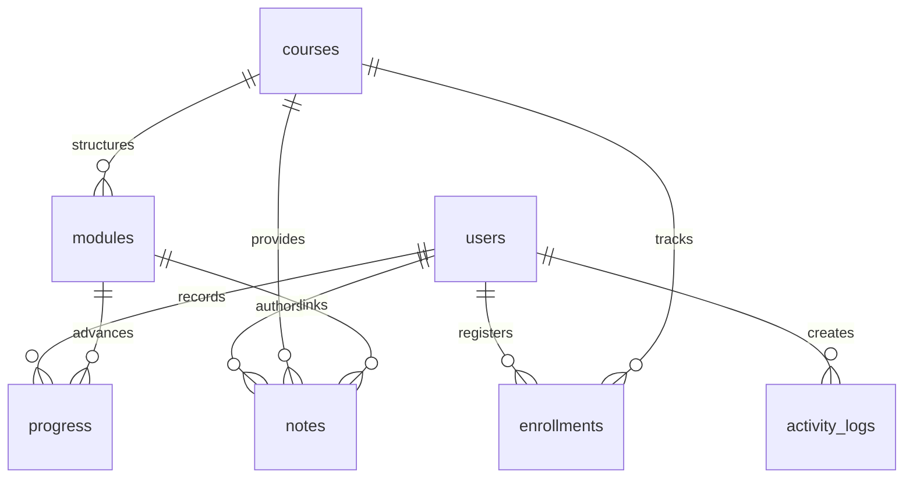

# 🪺 CodeNest — Free Coding Academy

[](backend/tests)
[](https://nodejs.org)
[](https://react.dev)
[](https://vitejs.dev)
[](https://tailwindcss.com)
[](https://tidbcloud.com)
[](https://vercel.com)
[](https://render.com)
[](LICENSE)

> A modern, open-source educational platform engineered to make quality programming education accessible to all learners. Built with React 19, Node.js, Express, and TiDB Cloud Serverless.

---

## 🌐 Live Production Links

- **Production Web Application:** [https://code-nest-ashy-ten.vercel.app/](https://code-nest-ashy-ten.vercel.app/)
- **Production Backend API:** [https://codenest-pt6j.onrender.com](https://codenest-pt6j.onrender.com)
- **API Health Check Probe:** [https://codenest-pt6j.onrender.com/api/health](https://codenest-pt6j.onrender.com/api/health)
- **Official GitHub Repository:** [https://github.com/anshbhatnagara-gif/CodeNest](https://github.com/anshbhatnagara-gif/CodeNest)

---

## 📖 1. Project Overview & Introduction

**CodeNest Free Academy** is an interactive, full-stack learning management system (LMS) specifically crafted for coding students, self-taught developers, and educators. The platform bridges the gap between static tutorials and interactive learning by offering curated programming courses, structured lesson modules, downloadable cheatsheets and study notes, and gamified progress tracking.

### The Problem
Traditional computer science education and paid bootcamps often present steep financial barriers, fragmented learning materials, and lack clear progression tracking for beginners. Self-taught students struggle with scattered video playlists, unstructured notes, and missing feedback loops on their learning trajectory.

### Project Objectives
1. **Zero Financial Barrier:** Provide 100% free programming courses with no paywalls or locked modules.
2. **Structured Curriculum:** Organize complex topics (HTML, CSS, JavaScript, MySQL, Python, C, Data Structures & Algorithms) into digestible, ordered modules.
3. **Gamified Motivation:** Reward consistency through experience points (XP), dynamic leveling, and course completion milestones.
4. **Centralized Learning Materials:** Integrate lecture summaries and downloadable PDF/DOCX notes directly within each lesson view.
5. **Secure & Maintainable Architecture:** Implement strict Role-Based Access Control (RBAC), parameterized SQL queries, defensive file handling, and automated test coverage.

---

## 🚀 2. Core Feature Highlights

### Student Functionality
- **Seamless Onboarding:** Fast account registration with password strength analysis and secure JWT issuance.
- **Course Discovery Catalog:** Browse published courses filtered by category (Web Development, Database, Programming, Computer Science) and difficulty (Beginner, Intermediate, Advanced) with instant live keyword search.
- **One-Click Enrollment:** Enroll instantly in any published course with immediate curriculum access.
- **Sequential Lesson Player:** Track lesson durations and mark modules as completed with immediate progress reflection.
- **Gamified Level Progression:** Earn +50 XP per lesson completed, dynamically advance levels, and unlock a +200 XP bonus upon completing an entire course.
- **"My Learning" Workspace:** Dedicated student dashboard featuring active course spotlighting, completion percentage bars, status filters, and one-click "Resume Course" deep-linking directly to the next unfinished lesson.
- **Notes & Resource Center:** Read markdown summaries directly in the browser and download verified PDF cheatsheets and lecture documents.

### Academy Owner & Administration Functionality
- **Dual-Gate Security Authentication:** Enforces database role verification (`role === 'owner'`) alongside strict environment variable verification (`OWNER_EMAIL`).
- **Owner Analytics Hub:** Monitor real-time counts for total students, total course enrollments, completed courses, and student activity distributions (Regular, Less Active, Inactive).
- **Recent Platform Activity Feed:** Audit trail showing the 20 most recent student events (registrations, logins, course enrollments, lesson completions).
- **Course Lifecycle Management:** Create, edit, publish/unpublish, and safely delete courses. Deletion is automatically guarded against if active student enrollments exist.
- **Module Sequence Organizer:** Add modules with automatic sequential indexing, update duration and lesson titles, and reorder curriculum modules using a collision-free two-phase transaction. Deletion is safely blocked if any student has completed the module.
- **Notes & File Management:** Author study notes, attach documents (up to 25 MB) with raw buffer file signature verification, toggle visibility between draft and published, and delete obsolete resources with automated disk cleanup.
- **Student Management:** View enrolled student records, inspect individual learning progress, and manage student accounts.

---

## 🛠️ 3. Technology Stack

| Layer | Technology | Version | Purpose |
|---|---|---|---|
| **Frontend Framework** | React | `^19.0.0` | Declarative user interface components |
| **Frontend Build Tool** | Vite | `^6.4.3` | Ultra-fast HMR and optimized Rollup production bundling |
| **Styling & Design** | Tailwind CSS | `^4.3.3` | Responsive utility-first design system and custom animations |
| **Routing** | React Router | `^7.18.4` | Client-side declarative routing and SPA navigation |
| **Icons & UI** | Lucide React | `^1.23.0` | Accessible and consistent iconography |
| **HTTP Client** | Axios | `^1.7.2` | Promise-based API requests with auth interceptors |
| **Backend Runtime** | Node.js | `>=18.0.0` | Server-side JavaScript runtime |
| **Backend Framework** | Express.js | `^4.19.2` | RESTful API server routing and middleware |
| **Database Engine** | TiDB Cloud Serverless | MySQL 8.0 Wire | Distributed cloud SQL database with enforced TLS 1.2+ |
| **Database Driver** | mysql2/promise | `^3.9.7` | High-performance MySQL driver with prepared statement pooling |
| **Authentication** | JSON Web Tokens & bcryptjs | `jwt: ^9.0.2`, `bcrypt: ^2.4.3` | HS256 signed stateless session tokens & 12-round password hashing |
| **Security Headers** | Helmet | `^7.1.0` | HTTP response security headers (CSP, HSTS, CORP) |
| **Compression** | compression | `^1.8.2` | Gzip HTTP response compression with threshold filters |
| **File Handling** | Multer | `^1.4.5-lts.1` | In-memory multipart buffer processing and file validation |
| **Object Storage SDK** | AWS SDK v3 S3 | `^3.587.0` | StorageAdapter supporting S3-compatible Cloudflare R2 |
| **Hosting Platform** | Vercel & Render | Cloud | Decoupled edge CDN frontend + scalable backend container |

---

## 📐 4. System Architecture

```mermaid
flowchart TD
    Client["Client Browser<br/>(Desktop / Mobile)"]
    
    subgraph FrontendHosting ["Frontend: Vercel Edge Network"]
        ViteApp["React 19 SPA<br/>(Tailwind CSS v4, AuthContext, ErrorBoundary)"]
    end
    
    subgraph BackendHosting ["Backend API: Render Web Service"]
        Express["Express.js Server (Port 5000 / $PORT)"]
        SecurityMW["Security: Helmet, CORS, RateLimiter, Compression"]
        AuthMW["Auth: JWT HS256 + token_version check"]
        OwnerMW["Owner Guard: role='owner' && email=OWNER_EMAIL"]
        APIs["API Controllers: Courses, Modules, Progress, Notes, Owner"]
        StorageAdapter["Storage Adapter (Local / Cloudflare R2)"]
    end
    
    subgraph CloudDB ["Database: TiDB Cloud Serverless"]
        TiDB[("TiDB Distributed Cluster<br/>(MySQL 8.0 Protocol, TLS 1.2 Enforced)")]
    end

    Client -->|HTTPS| ViteApp
    ViteApp -->|HTTPS /api/v1 Requests| Express
    Express --> SecurityMW
    SecurityMW --> AuthMW
    AuthMW --> OwnerMW
    AuthMW --> APIs
    OwnerMW --> APIs
    APIs -->|Connection Pool (mysql2)| TiDB
    APIs --> StorageAdapter
```

*For in-depth architectural sequence diagrams, consult [docs/ARCHITECTURE.md](docs/ARCHITECTURE.md).*

---

## 🗄️ 5. Database Structure

The database consists of 7 normalized relational tables enforcing referential integrity via foreign keys and unique constraints:



1. **`users`:** Stores student and owner identities, hashed passwords, session `token_version`, and cumulative `xp` and `level`.
2. **`courses`:** Holds course metadata, descriptions, category, difficulty, duration, thumbnail URLs, and `draft`/`published` status.
3. **`modules`:** Sequential lesson curriculum ordered by `order_index` with unique constraint `(course_id, order_index)`.
4. **`enrollments`:** Junction table linking users to courses with unique constraint `(user_id, course_id)`.
5. **`progress`:** Records module completions with unique constraint `(user_id, module_id)`.
6. **`activity_logs`:** Audit log capturing timestamps of registrations, logins, enrollments, and lesson completions.
7. **`notes`:** Markdown content and attachment metadata with indexed foreign keys for courses and modules.

*For complete schema DDL, indexes, and column types, consult [docs/DATABASE.md](docs/DATABASE.md).*

---

## 🔌 6. API Architecture & Endpoints

| Category | Method | Endpoint | Access Level | Description |
|---|:---:|---|---|---|
| **Health** | `GET` | `/api/health` | Public | Connectivity probe verifying database status and latency |
| **Auth** | `POST` | `/api/auth/register` | Public (Rate-limited) | Register student account with email, name, password |
| **Auth** | `POST` | `/api/auth/login` | Public (Rate-limited) | Authenticate user, update login time, issue JWT |
| **Auth** | `GET` | `/api/auth/profile` | Authenticated | Retrieve authenticated user profile and stats |
| **Auth** | `POST` | `/api/auth/logout` | Authenticated | Revoke active sessions by incrementing `token_version` |
| **Courses** | `GET` | `/api/courses` | Public / Optional Auth | List published courses with user enrollment status |
| **Courses** | `GET` | `/api/courses/:id` | Public / Optional Auth | Get course details and modules with completion state |
| **Courses** | `POST` | `/api/courses/:id/enroll` | Authenticated | Enroll current student in target published course |
| **Progress** | `GET` | `/api/progress/my-courses` | Authenticated | List all enrolled courses with progress percentages |
| **Progress** | `POST` | `/api/progress/module-complete` | Authenticated | Mark lesson complete, award XP (+50 XP / +200 bonus XP) |
| **Notes** | `GET` | `/api/notes` | Public | List published study notes for courses |
| **Notes** | `GET` | `/api/notes/:id` | Public | Retrieve single note metadata and markdown body |
| **Notes** | `GET` | `/api/notes/:id/download` | Authenticated | Securely stream or redirect to note attachment file |
| **Owner** | `GET` | `/api/owner/dashboard` | Owner Only | Get platform analytics, activity log, engagement metrics |
| **Owner** | `GET` | `/api/owner/students` | Owner Only | Get all registered students and regularity status |
| **Owner** | `GET` | `/api/owner/courses` | Owner Only | List all courses (draft & published) with metrics |
| **Owner** | `POST` | `/api/owner/courses` | Owner Only | Create a new course (defaults to draft) |
| **Owner** | `PUT` | `/api/owner/courses/:id` | Owner Only | Update course metadata with title uniqueness check |
| **Owner** | `PATCH` | `/api/owner/courses/:id/status` | Owner Only | Toggle status between draft and published |
| **Owner** | `DELETE` | `/api/owner/courses/:id` | Owner Only | Delete course (guarded against active enrollments) |
| **Owner** | `GET` | `/api/owner/courses/:id/modules` | Owner Only | Get course modules with completion statistics |
| **Owner** | `POST` | `/api/owner/courses/:id/modules` | Owner Only | Add module with auto order calculation |
| **Owner** | `PUT` | `/api/owner/courses/:id/modules/reorder` | Owner Only | Reorder modules via 2-phase transactional update |
| **Owner** | `PUT` | `/api/owner/modules/:id` | Owner Only | Edit module title and duration |
| **Owner** | `DELETE` | `/api/owner/modules/:id` | Owner Only | Delete module (guarded against student progress) |
| **Owner** | `GET` | `/api/owner/notes` | Owner Only | Get all notes with filtering by course, module, status |
| **Owner** | `POST` | `/api/owner/notes` | Owner Only | Upload and author note with optional file attachment |
| **Owner** | `DELETE` | `/api/owner/notes/:id` | Owner Only | Delete note and remove associated file from storage |

---

## 🔒 7. Authentication & Security Highlights

1. **Password Security:** Salted and hashed using `bcryptjs` with **12 salt rounds**. Byte lengths are verified to eliminate buffer truncation vulnerabilities.
2. **Session Revocation via `token_version`:** Each JWT payload contains the user's `token_version`. Logging out increments this counter in the database, immediately invalidating all active tokens without requiring heavy Redis blacklists.
3. **Dual-Gate Owner Authorization:** Owner endpoints require both database role verification (`role === 'owner'`) and environment email matching (`OWNER_EMAIL`).
4. **Parameterized SQL Queries:** Prevents SQL injection across 100% of database interactions using prepared statements (`pool.execute()`).
5. **Defensive File Storage:** Uploaded files undergo MIME type checking, buffer magic number verification, and path traversal sanitization before disk writes.
6. **Information Disclosure Prevention:** Production error responses sanitize error details, masking database connection strings, credentials, and internal stack traces.

---

## 📦 8. Repository Structure

```
CodeNest/
├── backend/                        # Node.js + Express API server
│   ├── config/                     # Database pool & storage adapter
│   │   ├── db.js                   # TiDB Cloud MySQL connection pool
│   │   └── storage.js              # StorageAdapter (Local / Cloudflare R2)
│   ├── controllers/                # Request handlers & business logic
│   ├── middleware/                 # Auth, Owner guard, CORS, Helmet, RateLimiter
│   ├── routes/                     # Express route declarations
│   ├── scripts/                    # Migration, seeding & owner promotion scripts
│   ├── sql/                        # Schema DDL, seed data & migrations
│   ├── tests/                      # Automated unit & integration tests (186 tests)
│   ├── package.json                # Backend dependencies & test scripts
│   └── server.js                   # Express application entrypoint
├── frontend/                       # React 19 + Vite single-page application
│   ├── public/                     # Static web assets & icons
│   ├── src/                        # Application source code
│   │   ├── components/             # Reusable UI components (Navbar, Footer, Modals)
│   │   ├── context/                # Global AuthContext & Axios instance
│   │   ├── hooks/                  # Custom React hooks (e.g. useEscapeKey)
│   │   ├── pages/                  # Page views (Courses, CourseDetail, MyLearning, etc.)
│   │   ├── utils/                  # Formatting & badge helpers
│   │   ├── App.jsx                 # Route declarations & ErrorBoundary
│   │   └── main.jsx                # Application root mount
│   ├── package.json                # Frontend dependencies & build scripts
│   ├── tailwind.config.js          # Tailwind CSS v4 configuration
│   ├── vercel.json                 # Vercel SPA routing rewrite rules
│   └── vite.config.js              # Vite build & proxy configuration
├── docs/                           # Comprehensive technical documentation
│   ├── ARCHITECTURE.md             # System architecture, data flow & sequence diagrams
│   ├── DATABASE.md                 # Complete schema reference & ERD
│   ├── DEPLOYMENT.md               # Production hosting guide (Vercel + Render + TiDB)
│   ├── FEATURES.md                 # Feature walkthrough by user role & roadmap
│   └── SETUP.md                    # Beginner-friendly local setup & running guide
├── CONTRIBUTING.md                  # Contribution guidelines & coding standards
├── LICENSE                         # MIT Open Source License
├── package.json                    # Repository root package configuration
├── render.yaml                     # Render Infrastructure-as-Code deployment blueprint
└── README.md                       # Main repository overview & presentation
```

---

## ⚡ 9. Local Development Quickstart

### Prerequisites
- Node.js (>= 18.0.0)
- npm (>= 9.0.0)
- Git
- Local MySQL 8.0 server OR free TiDB Cloud Serverless account

### 1. Clone the repository
```bash
git clone https://github.com/anshbhatnagara-gif/CodeNest.git
cd CodeNest
```

### 2. Configure & Start Backend
```bash
cd backend
npm install
cp .env.example .env
# Configure your DB credentials, JWT_SECRET, and OWNER_EMAIL in backend/.env

# Run database migration & initial course seeding:
node scripts/migrate.js

# Start backend dev server:
npm run dev
# Running on http://localhost:5000 (Health check: http://localhost:5000/api/health)
```

### 3. Configure & Start Frontend
```bash
# Open a new terminal:
cd frontend
npm install
cp .env.example .env
# Default VITE_API_URL=http://localhost:5000/api

# Start frontend dev server:
npm run dev
# Running on http://localhost:5173
```

*For comprehensive step-by-step instructions, consult [docs/SETUP.md](docs/SETUP.md).*

---

## 🧪 10. Automated Testing & Verification

The project includes an extensive suite of automated tests built using the native Node.js test runner (`node --test`):

```bash
# Run backend test suite:
cd backend
npm test
```

### Verified Test Results
```
ℹ tests 186
ℹ suites 24
ℹ pass 186
ℹ fail 0
ℹ duration_ms ~3600ms
```

### Verified Production Build
```bash
# Verify frontend production build:
cd frontend
npm run build
```
Builds cleanly into `frontend/dist/` in ~8 seconds with **zero errors and zero warnings**.

---

## 🚀 11. Production Deployment

The platform is deployed across decoupled cloud providers:
- **Frontend:** Hosted on [Vercel](https://vercel.com/) with root directory set to `frontend/`.
- **Backend:** Hosted on [Render](https://render.com/) with root directory set to `backend/`.
- **Database:** Hosted on [TiDB Cloud](https://tidbcloud.com/) Serverless (AWS `ap-southeast-1` region) with enforced TLS 1.2+ encryption.

*For complete environment variable tables and troubleshooting, consult [docs/DEPLOYMENT.md](docs/DEPLOYMENT.md).*

---

## ⚠️ 12. Current Limitations & Planned Improvements

| Area | Current Implementation | Planned Enhancement |
|---|---|---|
| **File Storage** | Runs on local filesystem (`STORAGE_PROVIDER=local`). Render free instances wipe files on container restarts. | Activate Cloudflare R2 object storage (`STORAGE_PROVIDER=r2`) for persistent downloads across redeploys. |
| **Frontend Tests** | Backend has 186 unit/integration tests; frontend relies on TypeScript/JSX compilation. | Add Vitest + React Testing Library for frontend component testing. |
| **Code Execution** | Static lesson modules with markdown and cheatsheets. | Add an in-browser code editor / runner (Monaco editor + WebWorkers). |
| **Certificates** | XP milestones and completion bonuses are logged in the database. | Automated PDF certificate generation upon course completion. |

---

## 🤝 13. Contributing

Contributions are welcome! Please read [CONTRIBUTING.md](CONTRIBUTING.md) for details on our code of conduct, development workflow, commit conventions, and pull request submission guidelines.

---

## 📄 14. License

This project is open-source software licensed under the **[MIT License](LICENSE)**.

---

<p align="center">
  Crafted with ❤️ by <strong>Ansh Bhatnagar</strong> and the CodeNest Team.
</p>
