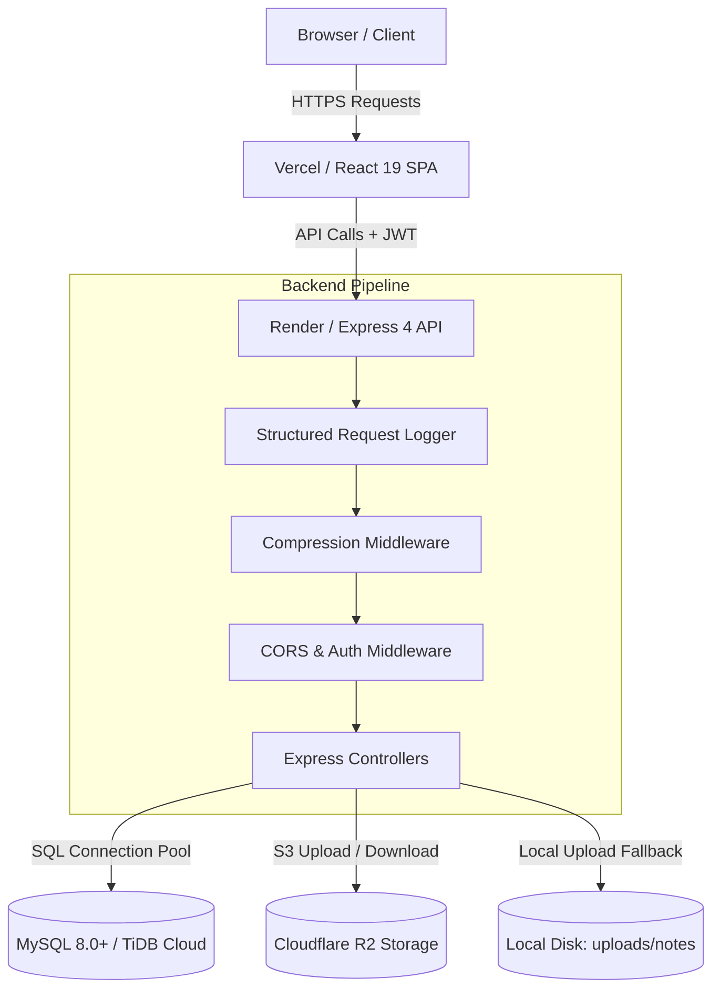
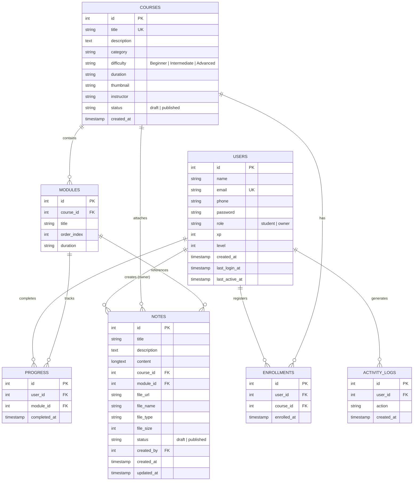

# CodeNest — Free Coding Academy

[](#)
[](#)
[](#)
[](#)
[](#)
[](#)
[](#)

**CodeNest Free Academy** is a modern, full-stack online learning platform built to deliver 100% free programming education. It provides interactive course progress tracking, downloadable lecture notes, student dashboard analytics, and an exclusive administration suite for course, module, and student management.


## 1. Features

### Student Learning Experience
* **Course Catalog:** Explore published courses with real-time text search and category filtering.
* **Curriculum & Lesson Modules:** Structured lesson modules with estimated duration, completion status, and direct-resume navigation (`?resume=true`).
* **Progress Tracking & Gamification:** Automatic module completion tracking awarding XP points and dynamic level advancement (500 XP per level).
* **Notes & Study Material:** View published lesson notes and securely download course attachments (PDF, DOCX, PPTX, images).
* **Personalized Dashboard:** Track enrolled courses, completion rates, overall XP progress, and active learning statistics.
   

### Academy Owner Administration
* **Academy Analytics:** Real-time dashboard tracking total registered students, course enrollments, completion metrics, and 24h/7d student regularity.
* **Course Management:** Full CRUD operations for courses, including draft/published toggling and deletion protection against active enrollments.
* **Module Sequencing:** Add, edit, delete, and reorder lesson modules using collision-free sequence compaction.
* **Notes & Attachments:** Create, edit, and publish rich study notes with file attachments up to 25 MB.
* **Student Roster Management:** Inspect student accounts, view learning progress, and manage enrollments.

### Platform Reliability & Observability
* **Object Storage Adapter:** Production-grade Cloudflare R2 (S3-compatible) storage with automatic fallback to local disk storage in development.
* **Active Health Check:** Active `/api/health` endpoint probing database connectivity with timeout and latency monitoring.
* **Structured Request Logging:** Lightweight JSON access logging correlating incoming requests with `X-Request-Id`.
* **HTTP Response Compression:** Gzip compression enabled for responses exceeding 1 KB.
* **Frontend Error Boundary:** React error boundary with graceful user recovery UI to isolate rendering failures.

---

## 2. User Roles & Permissions

CodeNest implements Role-Based Access Control (RBAC) powered by JSON Web Tokens (JWT):

| Capability | Guest / Visitor | Student | Academy Owner |
| :--- | :---: | :---: | :---: |
| View Public Welcome & About Pages | Yes | Yes | Yes |
| Browse Published Courses & Catalog | Yes | Yes | Yes |
| View Course Curriculum & Lesson Overview | Yes | Yes | Yes |
| Register & Authenticate | Yes | Yes | Yes |
| Enroll in Courses | No | Yes | Yes |
| Track Lesson Progress & Earn XP | No | Yes | Yes |
| Access Student Dashboard & My Learning | No | Yes | Yes |
| Download Lesson Notes & Attachments | No | Yes | Yes |
| Access Owner Administration Dashboard | No | No | Yes |
| Create / Edit / Delete Courses & Modules | No | No | Yes |
| Upload / Publish / Delete Course Notes | No | No | Yes |
| Manage Students & Inspect Audit Logs | No | No | Yes |

> **Owner Role Verification:** Academy Owner access requires both `role = 'owner'` in the database and an email matching the server's configured `OWNER_EMAIL` environment variable.

---

## 3. Screens & Pages Overview

The frontend single-page application includes 13 route components:

### Public & Authentication Views
* **Welcome (`/`):** Public landing page introducing the academy with course highlights, feature showcases, and calls-to-action.
* **Login (`/login`):** Authentication form with client-side validation and session initialization.
* **Register (`/register`):** Student account creation with email normalization, password strength indicator, and input sanitization.
* **Courses (`/courses`):** Searchable course catalog with category pills (Web Development, Frontend, Backend, Programming, Computer Science) and difficulty badges.
* **Course Detail (`/courses/:id`):** Course overview, instructor details, curriculum list, completion checkboxes, and study notes tab.

### Student Portal (Protected)
* **Home (`/home`):** Student welcome portal showcasing active enrollments and recommended courses.
* **Dashboard (`/dashboard`):** Student metrics overview displaying current level, XP progress bar, certificates, and learning stats.
* **My Learning (`/my-learning`):** Management page for enrolled courses with quick-resume lesson buttons and completion percentage.
* **Privacy Policy (`/privacy-policy`):** Information regarding data handling, account credentials, and platform policies.

### Owner Administration Portal (Owner-Only)
* **Owner Dashboard (`/owner-dashboard`):** Top-level metrics overview, student regularity charts (regular, less active, inactive), and recent system activity logs.
* **Owner Courses (`/owner-courses`):** Course administration table with search, draft/published status toggling, and create/edit/delete modals.
* **Owner Modules (`/owner-courses/:courseId/modules`):** Module sequencing editor for a specific course, featuring order incrementation and reordering controls.
* **Owner Notes (`/owner-notes`):** Study notes management interface with drag-and-drop file upload, MIME signature verification, and draft/published controls.

---

## 4. Technology Stack

### Frontend
* **Core:** React 19 (`react`, `react-dom`)
* **Build Tool & Dev Server:** Vite 5 / 6 (`vite`, `@vitejs/plugin-react`)
* **Routing:** React Router v6 / v7 (`react-router-dom`)
* **Styling:** Tailwind CSS v3 / v4 with PostCSS & Autoprefixer
* **Icons:** Lucide React (`lucide-react`)
* **HTTP Client:** Axios (`axios`) with automatic JWT interceptors
* **Static Production Server:** Serve (`serve`) for containerized / static serving

### Backend
* **Runtime:** Node.js (v18.x or v20.x recommended)
* **Web Framework:** Express 4 (`express`)
* **Database Driver:** `mysql2/promise` with connection pooling and SSL TLSv1.2 support
* **Security & Auth:** JSON Web Tokens (`jsonwebtoken`), Bcrypt (`bcryptjs`), Helmet (`helmet`), Express Rate Limit (`express-rate-limit`)
* **File Uploads & Storage:** Multer (`multer`), AWS SDK for JavaScript v3 (`@aws-sdk/client-s3`, `@aws-sdk/s3-request-presigner`)
* **Performance & Observability:** Express Compression (`compression`), Crypto UUID tracing

### Database & Cloud Services
* **Database:** MySQL 8.0+ (Local) or TiDB Cloud Serverless (Production)
* **Object Storage:** Cloudflare R2 (Production S3-compatible storage) or Local Disk (Development)
* **Hosting Platforms:** Render (Backend API), Vercel (Frontend SPA)

---

## 5. System Architecture



### Entity-Relationship Diagram



---

## 6. Folder Structure

```text
CodeNest/
|-- .gitignore                      # Hardened Git ignore rules
|-- DEPLOYMENT.md                   # Operational runbooks & deployment guide
|-- README.md                       # Comprehensive platform documentation
|
|-- backend/                        # Node.js + Express API Server
|   |-- config/
|   |   |-- db.js                   # MySQL2 connection pool & keep-alive
|   |   \-- storage.js              # Cloudflare R2 / Local Storage adapter
|   |-- controllers/
|   |   |-- authController.js       # Register, login, profile, logout
|   |   |-- courseController.js     # Public course catalog & enrollment
|   |   |-- notesController.js      # Student & owner notes management
|   |   |-- ownerController.js      # Owner dashboard analytics & student roster
|   |   |-- ownerCourseController.js# Owner course CRUD & status toggling
|   |   |-- ownerModuleController.js# Owner module management & reordering
|   |   \-- progressController.js   # Student module progress & XP awards
|   |-- middleware/
|   |   |-- authMiddleware.js       # JWT verification & optional auth
|   |   |-- ownerMiddleware.js      # Role & owner email verification
|   |   |-- uploadMiddleware.js     # Multer engine & file signature checks
|   |   |-- rateLimiter.js          # Authentication rate limiting
|   |   \-- corsConfig.js           # Production CORS whitelist options
|   |-- routes/                     # Express route declarations
|   |-- scripts/
|   |   |-- migrate.js              # Database migration & seeding runner
|   |   \-- promoteOwner.js         # CLI user role promotion utility
|   |-- sql/
|   |   |-- schema.sql              # MySQL DDL table schemas & indices
|   |   |-- seed.sql                # Idempotent starter course catalog
|   |   |-- add_notes_table.sql     # Standalone notes schema
|   |   \-- add_token_version.sql   # Token revocation migration
|   |-- tests/                      # Automated Node.js test suites
|   |-- uploads/notes/              # Local storage development directory
|   |-- .env.example                # Backend environment template
|   |-- package.json                # Backend scripts and dependencies
|   \-- server.js                   # Backend entrypoint and middleware pipeline
|
\-- frontend/                       # React 19 + Vite Single Page Application
    |-- public/                     # Static icons, favicons, robots.txt
    |-- src/
    |   |-- components/
    |   |   |-- CourseCard.jsx      # Reusable course display card
    |   |   |-- ErrorBoundary.jsx   # Global React crash fallback UI
    |   |   |-- Footer.jsx          # Application footer
    |   |   |-- Navbar.jsx          # Dynamic navigation with role checking
    |   |   |-- ProtectedRoute.jsx  # Route guard for student and owner pages
    |   |   \-- Toast.jsx           # Notification toast component
    |   |-- context/
    |   |   \-- AuthContext.jsx     # Global authentication state & axios instance
    |   |-- hooks/
    |   |   \-- useEscapeKey.js     # Keyboard accessibility hook for modals
    |   |-- pages/                  # Page route components
    |   |-- utils/
    |   |   \-- formatters.js       # File size and badge formatters
    |   |-- App.jsx                 # Lazy route declarations & Suspense wrapper
    |   |-- index.css               # Global Tailwind CSS directives
    |   \-- main.jsx                # Application DOM entrypoint
    |-- .env.example                # Frontend environment template
    |-- package.json                # Frontend scripts and dependencies
    \-- vite.config.js              # Vite configuration & bundle chunking
```

---

## 7. Installation Prerequisites

Before setting up CodeNest locally, ensure you have the following installed:

* **Node.js:** v18.18.0 or v20.x LTS or higher
* **npm:** v9.x or higher (bundled with Node.js)
* **MySQL:** v8.0 or higher (or access to a remote MySQL / TiDB instance)
* **Git:** v2.30 or higher

---

## 8. Local Development Setup

### 1. Clone the Repository
```bash
git clone https://github.com/anshbhatnagara-gif/CodeNest.git
cd CodeNest
```

### 2. Install Backend Dependencies
```bash
cd backend
npm install
cd ..
```

### 3. Install Frontend Dependencies
```bash
cd frontend
npm install
cd ..
```

---

## 9. Environment Variable Configuration

### Backend Configuration (`backend/.env`)
Create `backend/.env` by copying `backend/.env.example`:
```bash
cp backend/.env.example backend/.env
```

Populate the values for your local environment:
```env
# Server Port
PORT=5000

# Local MySQL Database Configuration
DB_HOST=localhost
DB_PORT=3306
DB_USER=root
DB_PASSWORD=your_local_mysql_password
DB_NAME=codenest_free_academy
DB_SSL=false

# JSON Web Token Secret (generate a secure random string)
JWT_SECRET=your_development_jwt_secret_key_minimum_32_characters

# Owner Account Email (matches the account that receives Owner privileges)
OWNER_EMAIL=owner@example.com

# Frontend URL for CORS Whitelisting
FRONTEND_URL=http://localhost:5173

# Notes Upload Configuration
MAX_NOTE_FILE_SIZE_MB=25

# Storage Provider ('local' for development disk storage, 'r2' for Cloudflare R2)
STORAGE_PROVIDER=local

# Cloudflare R2 Settings (Only required if STORAGE_PROVIDER=r2)
R2_ACCOUNT_ID=
R2_ACCESS_KEY_ID=
R2_SECRET_ACCESS_KEY=
R2_BUCKET_NAME=codenest-attachments
```

### Frontend Configuration (`frontend/.env`)
Create `frontend/.env` by copying `frontend/.env.example`:
```bash
cp frontend/.env.example frontend/.env
```

Populate the API endpoint URL:
```env
# Backend API Base URL
VITE_API_URL=http://localhost:5000/api
```

---

## 10. Database Setup & Seeding

> [!IMPORTANT]
> **SSL / TLS 1.2 Database Notice:**
> The automated migration script (`backend/scripts/migrate.js`) **enforces SSL TLS 1.2** by default (`ssl: { minVersion: 'TLSv1.2', rejectUnauthorized: true }`). It is specifically designed for cloud-hosted databases such as **TiDB Cloud Serverless**.
> * If you are running a **local MySQL instance without SSL**, use **Option B (Manual Setup via MySQL CLI)** below.
> * If you are connecting to **TiDB Cloud or an SSL-enabled MySQL instance**, use **Option A**.

### SQL File Overview & Roles
* `backend/sql/schema.sql`: Contains the complete, consolidated DDL schema for all primary tables (`users`, `courses`, `modules`, `enrollments`, `progress`, `activity_logs`, and `notes`). **The `notes` table is already included directly in `schema.sql`.**
* `backend/sql/seed.sql`: Idempotent seed data inserting 10 initial courses and their lesson modules using `WHERE NOT EXISTS` guards.
* `backend/sql/add_notes_table.sql`: Legacy standalone table definition for `notes` (already incorporated into `schema.sql`; do not run separately on a fresh setup).
* `backend/sql/add_token_version.sql`: Standalone manual migration script for adding the `token_version` column to the `users` table for session revocation. This is **not executed by `migrate.js`** and must be applied manually if user session invalidation schema is needed.

### Option A: Automated Cloud/SSL Migration Script (TiDB Cloud)
Ensure `DB_HOST`, `DB_PORT`, `DB_USER`, `DB_PASSWORD`, and `DB_NAME` are configured in `backend/.env`, then execute:
```bash
node backend/scripts/migrate.js
```
This script will:
1. Connect to MySQL/TiDB via TLS 1.2 and automatically execute `CREATE DATABASE IF NOT EXISTS codenest_free_academy;`.
2. Apply `backend/sql/schema.sql` to construct tables and unique indices.
3. Apply `backend/sql/seed.sql` to populate courses and modules idempotently.

### Option B: Local Non-SSL Setup (MySQL CLI)
For standard local MySQL servers where SSL is not configured:
```bash
# 1. Create Database
mysql -u root -p -e "CREATE DATABASE IF NOT EXISTS codenest_free_academy;"

# 2. Apply Schema (includes users, courses, modules, enrollments, progress, activity_logs, and notes)
mysql -u root -p codenest_free_academy < backend/sql/schema.sql

# 3. Apply Seed Data
mysql -u root -p codenest_free_academy < backend/sql/seed.sql
```

### Promoting an Owner User
To grant an account Owner permissions:
```bash
# Register an account first via the UI or API, then run:
node backend/scripts/promoteOwner.js your_email@example.com
```
*(Note: `your_email@example.com` must match the `OWNER_EMAIL` variable defined in `backend/.env`.)*

---

## 11. Running the Application

### Start the Backend Server
```bash
cd backend

# Development mode with live reload (nodemon)
npm run dev

# Standard production start
npm start
```
The backend API server will start on `http://localhost:5000`. Verify with:
```bash
curl http://localhost:5000/api/health
```

### Start the Frontend Dev Server
In a separate terminal window:
```bash
cd frontend

# Development server with Hot Module Replacement (Vite)
npm run dev
```
Open your browser at `http://localhost:5173` to explore the application.

---

## 12. Testing Instructions

CodeNest includes comprehensive automated unit and integration tests powered by Node.js's native test runner (`node:test`).

### Run Backend Test Suite
```bash
cd backend
npm test
```

### Test Suites Covered
* `tests/health.test.js`: Validates `/api/health` active database probe, latency calculations, timeout handling, and credential leak prevention.
* `tests/observability.test.js`: Verifies `X-Request-Id` injection, JSON structured logging, and Gzip response compression.
* `tests/storage.test.js`: Tests local disk storage fallback, path-traversal prevention, buffer validation, and Cloudflare R2 S3 operations.
* `tests/queryOptimization.test.js`: Verifies query column projection, `Cache-Control` header policies, and dashboard metrics queries.
* `tests/ownerCourses.test.js`: Validates owner course CRUD, RBAC restrictions, status toggling, and enrollment deletion guards.
* `tests/ownerModules.test.js`: Tests module creation, duration validation, sequence compaction, and two-phase reordering.

### Build and Test Frontend
```bash
cd frontend

# Run production build and bundle size verification
npm run build

# Preview production build locally
npm run preview
```

---

## 13. API Reference

All API routes are prefixed with `/api`. Authenticated endpoints require a Bearer token in the `Authorization` header: `Authorization: Bearer <token>`.

### Public & Authentication Endpoints
| Method | Endpoint | Description | Auth Required |
| :--- | :--- | :--- | :---: |
| `GET` | `/api/health` | Active system & database connectivity probe | No |
| `POST` | `/api/auth/register` | Register a new student account | No |
| `POST` | `/api/auth/login` | Authenticate and obtain JWT token | No |
| `GET` | `/api/auth/profile` | Retrieve current authenticated user profile | Yes |
| `POST` | `/api/auth/logout` | Revoke current session token | Yes |

### Course & Progress Endpoints
| Method | Endpoint | Description | Auth Required |
| :--- | :--- | :--- | :---: |
| `GET` | `/api/courses` | List published courses (includes user enrollment status if logged in) | Optional |
| `GET` | `/api/courses/:id` | Fetch course details, lessons, and completion percentage | Optional |
| `POST` | `/api/courses/:id/enroll` | Enroll current student in course | Yes |
| `GET` | `/api/progress/my-courses` | List enrolled courses and progress metrics | Yes |
| `POST` | `/api/progress/module-complete` | Mark lesson module complete and award XP | Yes |

### Study Notes Endpoints
| Method | Endpoint | Description | Auth Required |
| :--- | :--- | :--- | :---: |
| `GET` | `/api/notes` | List published study notes (filter by `course_id`, `module_id`) | No |
| `GET` | `/api/notes/:id` | Retrieve single note metadata and content | No |
| `GET` | `/api/notes/:id/download` | Download attachment via pre-signed URL or stream | Yes |

### Owner Administration Endpoints (Requires `role=owner`)
| Method | Endpoint | Description | Auth Required |
| :--- | :--- | :--- | :---: |
| `GET` | `/api/owner/dashboard` | Academy-wide statistics, regularity, and activity feed | Yes (Owner) |
| `GET` | `/api/owner/students` | List all registered students and their enrollments | Yes (Owner) |
| `GET` | `/api/owner/students/:id` | Fetch detailed profile and activity of a student | Yes (Owner) |
| `DELETE` | `/api/owner/students/:id` | Delete student account and cascade enrollments | Yes (Owner) |
| `GET` | `/api/owner/activity` | Retrieve recent student activity log | Yes (Owner) |
| `GET` | `/api/owner/courses` | List all courses (draft & published) with metrics | Yes (Owner) |
| `POST` | `/api/owner/courses` | Create new course (defaults to draft) | Yes (Owner) |
| `PUT` | `/api/owner/courses/:id` | Update course metadata | Yes (Owner) |
| `PATCH` | `/api/owner/courses/:id/status` | Toggle course between `draft` and `published` | Yes (Owner) |
| `DELETE` | `/api/owner/courses/:id` | Delete course (blocked if active enrollments exist) | Yes (Owner) |
| `GET` | `/api/owner/courses/:courseId/modules` | List modules for a course with completed counts | Yes (Owner) |
| `POST` | `/api/owner/courses/:courseId/modules` | Add module with automatic sequential order index | Yes (Owner) |
| `PUT` | `/api/owner/courses/:courseId/modules/reorder` | Atomically reorder modules via two-phase indexing | Yes (Owner) |
| `PUT` | `/api/owner/modules/:id` | Update module title or duration | Yes (Owner) |
| `DELETE` | `/api/owner/modules/:id` | Delete module (blocked if student progress exists) | Yes (Owner) |
| `GET` | `/api/owner/notes` | List all notes (draft & published) with file details | Yes (Owner) |
| `POST` | `/api/owner/notes` | Create study note with optional file attachment | Yes (Owner) |
| `PUT` | `/api/owner/notes/:id` | Update note content or replace attachment | Yes (Owner) |
| `POST` | `/api/owner/notes/:id/upload` | Dedicated file attachment upload/replace for a note | Yes (Owner) |
| `PATCH` | `/api/owner/notes/:id/status` | Toggle note between `draft` and `published` | Yes (Owner) |
| `DELETE` | `/api/owner/notes/:id` | Delete note and remove file from storage | Yes (Owner) |

---

## 14. File Storage Architecture

CodeNest uses a decoupled storage adapter (`backend/config/storage.js`) supporting two operating modes:

### Local Storage Mode (Development)
* Set `STORAGE_PROVIDER=local` in `backend/.env`.
* Files are uploaded to `backend/uploads/notes/` using unique timestamps: `note-<timestamp>-<random>.<ext>`.
* Downloads are served via authenticated streaming through Express.
* Includes path traversal guards rejecting `../`, absolute paths, and null bytes.

### Cloudflare R2 Mode (Production)
* Set `STORAGE_PROVIDER=r2` in `backend/.env` along with Cloudflare API credentials.
* Files are validated in memory and uploaded directly to Cloudflare R2 using `@aws-sdk/client-s3`.
* Downloads generate short-lived pre-signed URLs (300-second TTL) using `@aws-sdk/s3-request-presigner`.
* Deleting a note automatically sends a `DeleteObjectCommand` to Cloudflare R2 to prevent orphaned storage.

---

## 15. Troubleshooting

### Database Connection Fails
* **Error:** `ECONNREFUSED 127.0.0.1:3306`
  * Ensure the local MySQL service is running (`net start MySQL80` on Windows, or `sudo systemctl start mysql` on Linux).
  * Verify credentials in `backend/.env` match your local MySQL configuration.
* **Error:** `Access denied for user 'root'@'localhost'`
  * Confirm that `DB_PASSWORD` in `backend/.env` matches your root password.

### Port Conflicts
* **Error:** `EADDRINUSE: address already in use :::5000`
  * Terminate the process currently listening on port 5000:
    ```bash
    # Windows PowerShell
    Get-Process -Id (Get-NetTCPConnection -LocalPort 5000).OwningProcess | Stop-Process -Force
    ```

### CORS Issues
* **Error:** `Blocked CORS request from origin: http://localhost:5173`
  * Ensure `FRONTEND_URL=http://localhost:5173` is set in `backend/.env`.

### File Upload Rejection
* **Error:** `Invalid file content. File bytes do not match declared extension.`
  * CodeNest validates both file extensions and binary magic signatures. Ensure you are uploading a valid PDF, DOCX, PPTX, TXT, PNG, or JPEG file.

---

## 16. Production Deployment Guidelines

For operational runbooks, backup strategies, and migration steps, refer to [DEPLOYMENT.md](DEPLOYMENT.md).

### Recommended Production Architecture
* **Frontend:** Hosted on **Vercel** connected to the Git repository. Set build directory to `frontend`, build command to `npm run build`, and output to `dist`. Set `VITE_API_URL` to your production API URL.
* **Backend:** Hosted on **Render** (Web Service). Set root directory to `backend`, build command to `npm install`, and start command to `npm start`. Configure production environment variables and enable SSL.
* **Database:** Hosted on **TiDB Cloud Serverless** requiring SSL TLSv1.2 (`DB_SSL=true`).
* **Object Storage:** Hosted on **Cloudflare R2** with bucket permissions for S3 API uploads and pre-signed downloads.

---

## 17. Contribution Guidelines

1. **Branch Naming:** Use feature branches following the convention `feat/<feature-name>`, `fix/<issue-name>`, or `refactor/<name>`.
2. **Coding Standards:** Keep controllers focused, extract reusable queries, and avoid duplicate business logic.
3. **Security:** Never commit credentials, `.env` files, or private access tokens.
4. **Testing:** Run `npm test` in `backend/` and `npm run build` in `frontend/` before opening a Pull Request.

---

## 18. License

This project is open-source software licensed under the [MIT License](LICENSE).
