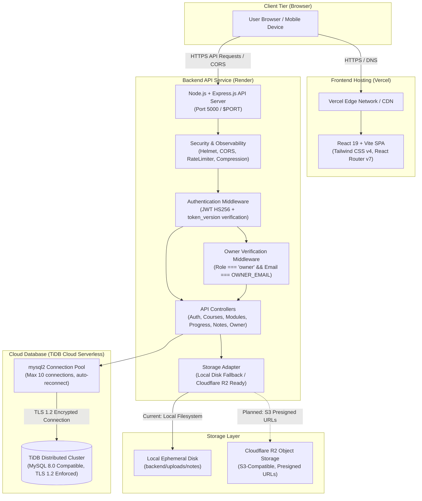
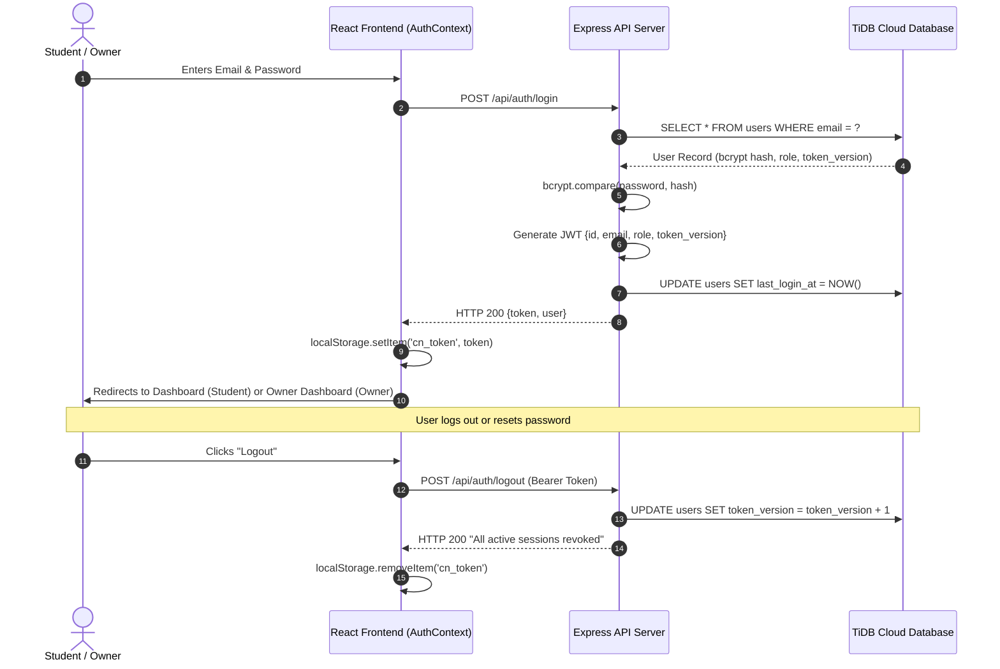
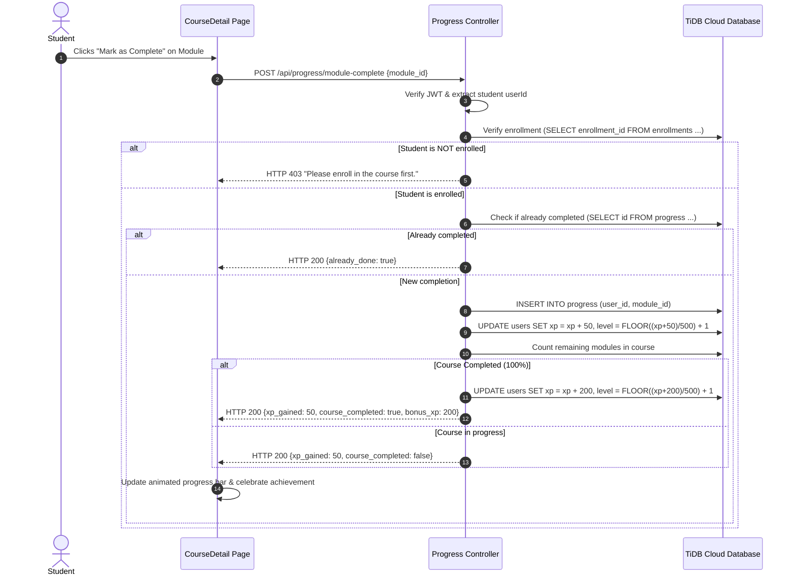
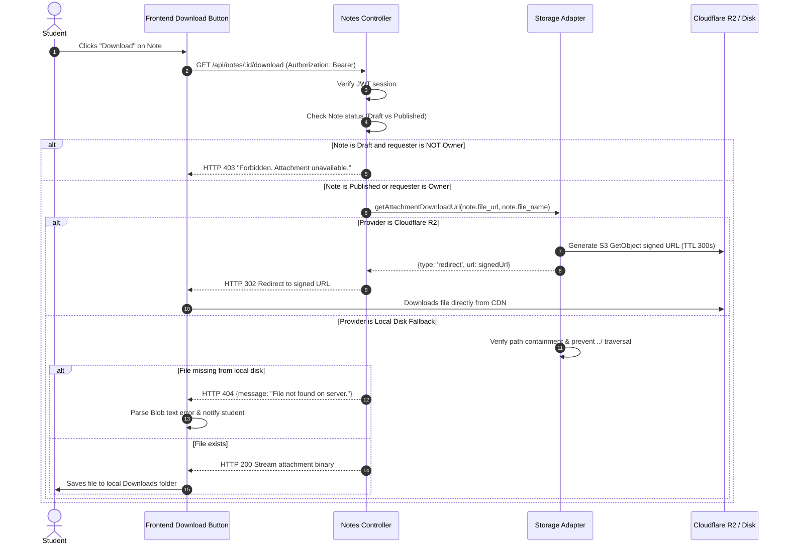

# 🏗️ CodeNest Architecture Blueprint

This document details the complete end-to-end architecture of **CodeNest – Free Coding Academy**, an open-source, full-stack educational platform built with React, Node.js, Express, and TiDB Cloud.

---

## 1. High-Level System Architecture

CodeNest is architected as a decoupled, multi-tier client-server application optimized for security, performance, and cost-effective cloud deployment.

---

## 2. Core Architectural Layers

### 2.1 Client & Presentation Layer (Frontend)
- **Framework:** React 19 with Vite 6 build system.
- **Routing:** React Router v7 with single-page application (SPA) client-side routing.
- **Styling:** Modern Tailwind CSS v4 featuring responsive flex/grid layouts and animated UI components.
- **State & Context Management:**
  - `AuthContext`: Centralized React Context managing JWT token persistence (`localStorage.getItem('cn_token')`), user profile state, login, registration, and logout.
  - Axios HTTP Interceptors: Automatically injects `Authorization: Bearer <token>` into outbound requests and catches `401 Unauthorized` responses to purge expired tokens.
- **Security Boundaries:**
  - `ProtectedRoute`: Guards student dashboards and user profiles from unauthenticated visitors.
  - `ProtectedRoute (ownerOnly)`: Restricts administrative tools (`/owner-dashboard`, `/owner-courses`, `/owner-modules`, `/owner-notes`) exclusively to users with `role === 'owner'`.
  - `ErrorBoundary`: Catches unhandled React component rendering exceptions and renders a friendly recovery screen.

### 2.2 Application & Business Logic Layer (Backend)
- **Runtime:** Node.js (v18.0.0+) with Express.js 4.19+.
- **Middleware Pipeline:**
  1. **Proxy Trust:** Configured for cloud load balancers (`app.set('trust proxy', 1)`).
  2. **Security Headers (Helmet):** Sets `Cross-Origin-Resource-Policy: cross-origin`, strict `Content-Security-Policy`, and `HSTS`.
  3. **Request Tracing:** Assigns a unique UUID v4 to incoming requests (`X-Request-Id`) and logs structured JSON telemetry.
  4. **HTTP Response Compression:** Gzip compression with a 1 KB threshold and `x-no-compression` header bypass support.
  5. **CORS Enforcement:** Dynamic origin validation strictly matching configured frontend domains (`FRONTEND_URL`, `CORS_ORIGIN`).
  6. **Rate Limiting:** Protects sensitive authentication endpoints (`/api/auth/login`, `/api/auth/register`) from brute-force attempts.
  7. **Central Error Handler:** Formats unexpected server exceptions into sanitized JSON responses, masking internal database stacks in production.

### 2.3 Data Persistence Layer (TiDB Cloud)
- **Engine:** TiDB Serverless Cloud Cluster on AWS (MySQL 8.0 protocol compatible).
- **Security:** TLS 1.2+ mandatory encryption (`rejectUnauthorized: true`).
- **Connection Management:** Connection pooling via `mysql2/promise` with automatic keep-alive pings and subquery optimization.
- **Data Integrity:** Foreign key constraints with `ON DELETE CASCADE` and unique constraints (`uq_course_title`, `uq_course_module_order`, `unique_enrollment`, `unique_progress`).

### 2.4 File Storage Layer (Storage Adapter Pattern)
- **Adapter Class:** `StorageAdapter` (`backend/config/storage.js`).
- **Modes of Operation:**
  - **Local Storage Mode (Current):** Saves uploads to `backend/uploads/notes` with defensive filename sanitization, path traversal checks, and authenticated streaming via `res.download`.
  - **Cloudflare R2 Mode (Planned Migration):** Connects to Cloudflare R2 bucket via `@aws-sdk/client-s3`, generating 300-second expiring presigned download URLs.

---

## 3. Key Interaction & Sequence Flows

### 3.1 Authentication & Session Revocation Flow

---

### 3.2 Course Progress & Gamification Flow

---

### 3.3 Secure Notes Attachment Download Flow

---

## 4. Security Architecture

1. **Defense-in-Depth Authentication:**
   - Password inputs are checked for length (8–128 characters) and UTF-8 byte size (max 72 bytes) before reaching `bcrypt`.
   - JWT signatures use `HS256` with strong 32-character minimum secrets.
   - Dual-gate Owner validation prevents unauthorized administrative access even if an account is manually altered to role `'owner'`.
2. **SQL Injection Defense:**
   - 100% of dynamic database queries use parameterized prepared statements (`pool.execute(query, [params])`).
3. **MIME Sniffing & Path Traversal Prevention:**
   - Uploaded files have their raw buffers inspected for file magic numbers (`%PDF-`, `PK\x03\x04`, etc.) rather than trusting user-supplied file extensions.
   - File deletion and retrieval routines strictly enforce path containment inside designated upload directories.
4. **Information Disclosure Prevention:**
   - Production error handlers catch exceptions and strip SQL state codes, internal file paths, and environment details.
   - Database health check endpoints verify cluster connectivity with a timeout without returning connection strings.
