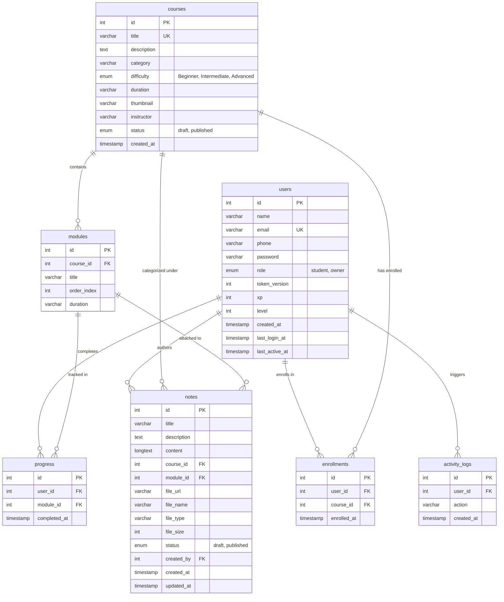

# 🗄️ CodeNest Database Schema Documentation

This document provides a comprehensive reference of the relational database schema, table structures, constraints, indexes, and entity relationships powering **CodeNest – Free Coding Academy**.

---

## 1. Database Architecture Overview

- **Engine:** TiDB Cloud Serverless (MySQL 8.0 wire protocol compatible).
- **Default Database Name:** `codenest_free_academy`.
- **Character Set & Collation:** `utf8mb4` / `utf8mb4_unicode_ci`.
- **Connection Transport:** SSL / TLS 1.2+ mandatory.
- **ORM / Driver:** Raw SQL via `mysql2/promise` with prepared statements.

---

## 2. Entity Relationship Diagram (ERD)

---

## 3. Table Definitions & Column Specifications

### 3.1 `users`
Stores student and owner user accounts, authentication credentials, session tracking versions, and gamification metrics.

| Column | Type | Nullable | Default | Description |
|---|---|---|---|---|
| `id` | `INT` | NO | Auto-Increment | Primary Key |
| `name` | `VARCHAR(100)` | NO | None | User's full name (trimmed, 1–100 chars) |
| `email` | `VARCHAR(150)` | NO | None | Unique login email address (normalized lowercase) |
| `phone` | `VARCHAR(20)` | YES | `''` | Optional contact phone number |
| `password` | `VARCHAR(255)` | NO | None | Bcrypt password hash (12 salt rounds) |
| `role` | `ENUM('student','owner')` | NO | `'student'` | Authorization role for RBAC enforcement |
| `token_version` | `INT` | NO | `1` | Incrementing version for instant JWT revocation |
| `xp` | `INT` | YES | `0` | Cumulative gamification experience points |
| `level` | `INT` | YES | `1` | Calculated level (`FLOOR(xp / 500) + 1`) |
| `created_at` | `TIMESTAMP` | YES | `CURRENT_TIMESTAMP` | Account registration timestamp |
| `last_login_at` | `TIMESTAMP` | YES | `NULL` | Timestamp of most recent successful login |
| `last_active_at` | `TIMESTAMP` | YES | `NULL` | Timestamp of most recent API interaction |

- **Primary Key:** `id`
- **Unique Constraints:** `email` (`UNIQUE KEY (email)`)
- **Indexes:** Primary (`id`), Unique (`email`).

---

### 3.2 `courses`
Stores course metadata, difficulty levels, duration estimates, publication statuses, and presentation details.

| Column | Type | Nullable | Default | Description |
|---|---|---|---|---|
| `id` | `INT` | NO | Auto-Increment | Primary Key |
| `title` | `VARCHAR(200)` | NO | None | Unique course title |
| `description` | `TEXT` | YES | `NULL` | Detailed course overview and curriculum description |
| `category` | `VARCHAR(100)` | YES | `'General'` | Course domain (e.g. Web Development, Programming) |
| `difficulty` | `ENUM('Beginner','Intermediate','Advanced')` | YES | `'Beginner'` | Course skill tier |
| `duration` | `VARCHAR(50)` | YES | `'0 hours'` | Estimated completion time |
| `thumbnail` | `VARCHAR(500)` | YES | `''` | Public image URL for card header |
| `instructor` | `VARCHAR(100)` | YES | `'CodeNest Faculty'` | Lead instructor or creator name |
| `status` | `ENUM('draft','published')` | NO | `'draft'` | Publication status (drafts hidden from students) |
| `created_at` | `TIMESTAMP` | YES | `CURRENT_TIMESTAMP` | Course creation timestamp |

- **Primary Key:** `id`
- **Unique Constraints:** `uq_course_title` (`UNIQUE KEY (title)`)
- **Indexes:** Primary (`id`), Unique (`title`).

---

### 3.3 `modules`
Contains individual lessons or study chapters that belong to a course, organized in sequential display order.

| Column | Type | Nullable | Default | Description |
|---|---|---|---|---|
| `id` | `INT` | NO | Auto-Increment | Primary Key |
| `course_id` | `INT` | NO | None | Foreign Key referencing parent course |
| `title` | `VARCHAR(200)` | NO | None | Module title (e.g. "Semantic HTML Tags") |
| `order_index` | `INT` | YES | `0` | Sequential position within course (1..N) |
| `duration` | `VARCHAR(50)` | YES | `'15 min'` | Estimated study duration for this lesson |

- **Primary Key:** `id`
- **Foreign Keys:** `course_id` REFERENCES `courses(id)` ON DELETE CASCADE
- **Unique Constraints:** `uq_course_module_order` (`UNIQUE KEY (course_id, order_index)`)
- **Indexes:** Primary (`id`), Unique Composite (`course_id`, `order_index`).

---

### 3.4 `enrollments`
Tracks many-to-many relationships between students and the courses they are actively learning.

| Column | Type | Nullable | Default | Description |
|---|---|---|---|---|
| `id` | `INT` | NO | Auto-Increment | Primary Key |
| `user_id` | `INT` | NO | None | Foreign Key referencing enrolled student |
| `course_id` | `INT` | NO | None | Foreign Key referencing target course |
| `enrolled_at` | `TIMESTAMP` | YES | `CURRENT_TIMESTAMP` | Enrollment timestamp |

- **Primary Key:** `id`
- **Foreign Keys:**
  - `user_id` REFERENCES `users(id)` ON DELETE CASCADE
  - `course_id` REFERENCES `courses(id)` ON DELETE CASCADE
- **Unique Constraints:** `unique_enrollment` (`UNIQUE KEY (user_id, course_id)`)
- **Indexes:** Primary (`id`), Unique Composite (`user_id`, `course_id`), FK (`course_id`).

---

### 3.5 `progress`
Records completed modules per student, powering lesson checkmarks, XP allocation, and course completion percentages.

| Column | Type | Nullable | Default | Description |
|---|---|---|---|---|
| `id` | `INT` | NO | Auto-Increment | Primary Key |
| `user_id` | `INT` | NO | None | Foreign Key referencing student |
| `module_id` | `INT` | NO | None | Foreign Key referencing completed module |
| `completed_at` | `TIMESTAMP` | YES | `CURRENT_TIMESTAMP` | Timestamp of completion |

- **Primary Key:** `id`
- **Foreign Keys:**
  - `user_id` REFERENCES `users(id)` ON DELETE CASCADE
  - `module_id` REFERENCES `modules(id)` ON DELETE CASCADE
- **Unique Constraints:** `unique_progress` (`UNIQUE KEY (user_id, module_id)`)
- **Indexes:** Primary (`id`), Unique Composite (`user_id`, `module_id`), FK (`module_id`).

---

### 3.6 `activity_logs`
Audit log recording major student actions (registration, login, course enrollment, module completions, logout).

| Column | Type | Nullable | Default | Description |
|---|---|---|---|---|
| `id` | `INT` | NO | Auto-Increment | Primary Key |
| `user_id` | `INT` | NO | None | Foreign Key referencing actor |
| `action` | `VARCHAR(200)` | YES | `NULL` | Human-readable description of performed action |
| `created_at` | `TIMESTAMP` | YES | `CURRENT_TIMESTAMP` | Activity event timestamp |

- **Primary Key:** `id`
- **Foreign Keys:** `user_id` REFERENCES `users(id)` ON DELETE CASCADE
- **Indexes:** Primary (`id`), FK (`user_id`).

---

### 3.7 `notes`
Stores study notes, cheatsheets, lecture summaries, and downloadable PDF/DOCX resource attachments.

| Column | Type | Nullable | Default | Description |
|---|---|---|---|---|
| `id` | `INT` | NO | Auto-Increment | Primary Key |
| `title` | `VARCHAR(255)` | NO | None | Note title |
| `description` | `TEXT` | YES | `NULL` | Brief summary of note contents |
| `content` | `LONGTEXT` | YES | `NULL` | Markdown-formatted study content |
| `course_id` | `INT` | NO | None | Foreign Key referencing associated course |
| `module_id` | `INT` | YES | `NULL` | Optional Foreign Key linking note to specific lesson |
| `file_url` | `VARCHAR(1000)` | YES | `NULL` | Local path or Cloudflare R2 object key |
| `file_name` | `VARCHAR(255)` | YES | `NULL` | Original upload filename (e.g. "HTML_Notes.pdf") |
| `file_type` | `VARCHAR(50)` | YES | `NULL` | Normalized file format badge (PDF, DOCX, etc.) |
| `file_size` | `INT` | YES | `NULL` | File size in bytes |
| `status` | `ENUM('draft','published')` | YES | `'draft'` | Visibility (draft notes restricted to owner) |
| `created_by` | `INT` | NO | None | Foreign Key referencing creator (owner user ID) |
| `created_at` | `TIMESTAMP` | YES | `CURRENT_TIMESTAMP` | Creation timestamp |
| `updated_at` | `TIMESTAMP` | YES | `CURRENT_TIMESTAMP` | Auto-updating modification timestamp |

- **Primary Key:** `id`
- **Foreign Keys:**
  - `course_id` REFERENCES `courses(id)` ON DELETE CASCADE
  - `module_id` REFERENCES `modules(id)` ON DELETE SET NULL
  - `created_by` REFERENCES `users(id)` ON DELETE CASCADE
- **Indexes:**
  - `idx_notes_course` (`course_id`)
  - `idx_notes_module` (`module_id`)
  - `idx_notes_status` (`status`)
  - `idx_notes_created_by` (`created_by`)

---

## 4. Migration & Seeding Scripts

| Script File | Purpose | Execution Command |
|---|---|---|
| [`backend/sql/schema.sql`](file:///c:/CodeNest/backend/sql/schema.sql) | DDL schema script creating all tables, keys, and foreign constraints | `mysql -u ... < backend/sql/schema.sql` |
| [`backend/sql/seed.sql`](file:///c:/CodeNest/backend/sql/seed.sql) | Seeds initial 7 courses, 60+ curriculum modules, and sample notes | `mysql -u ... < backend/sql/seed.sql` |
| [`backend/scripts/migrate.js`](file:///c:/CodeNest/backend/scripts/migrate.js) | Node.js migration runner: connects over SSL and applies schema and seed files | `node backend/scripts/migrate.js` |
| [`backend/scripts/promoteOwner.js`](file:///c:/CodeNest/backend/scripts/promoteOwner.js) | Safely promotes an existing registered user to the `owner` role | `node backend/scripts/promoteOwner.js <email>` |
